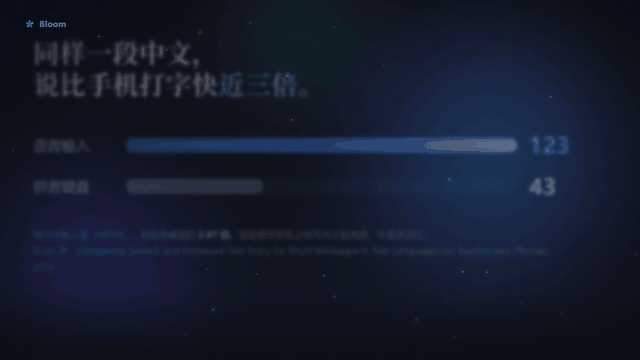

https://github.com/user-attachments/assets/815369c9-5372-4953-84ec-d6c1b68a329c

# Bloom

<p align="center"></p>

开组会用的 AI 助手。会上它听大家讨论，被叫到时用语音回答；主持人说定一处改法，它就去改论文，改动用修订标记显示在稿子上。散会后可以看修订对比、逐字稿和纪要。

## 安装

Windows 10/11（64 位）。在 PowerShell 里运行：

```powershell
irm https://raw.githubusercontent.com/lightblue888/bloom-meeting/main/install.ps1 | iex
```

装好后从开始菜单打开 Bloom。以后更新，再运行一次这条命令。

## 第一次打开

到 **设置 → 通用 → 模型来源**，选一家服务商（DeepSeek、Kimi、智谱 GLM、通义千问、Anthropic），粘贴 API key，点保存。费用按用量从你在那家的账户扣。

## 开会

1. 把论文拖进窗口。支持 PDF、Word、Markdown、LaTeX。
2. 点 **开会**。
3. 讨论时叫 AI 的名字提问。说定一处改法，它会记下来去改。
4. 点 **散会**。以往的会议在 **回顾** 里。

开 Bloom 的人是主持人，可以把参会的人设为共同主持人。只有主持人和共同主持人说的改法会被执行。

昵称、头像、颜色和 AI 的名字在 **设置 → 通用 → 个人资料** 里改。

## 邀请别人进会

别人用浏览器打开邀请链接就能进会。这需要一台有公网地址的服务器跑会议中继，见 [relay/README.md](relay/README.md)。不配中继也能一个人用。

## 隐私

录屏、逐字稿和论文只存在你自己的电脑上，API key 也只存在本机。开了邀请链接时，会议内容经你自己的中继转发，中继不把论文和逐字稿写到磁盘上。

更多设置和从源码构建见 [docs/advanced.md](docs/advanced.md)。

## 许可

MIT。桌面端改自开源项目 Blurt（MIT），原许可见 [desktop/LICENSE](desktop/LICENSE)。MathJax 为 Apache-2.0。

---

Bloom is an AI assistant for research group meetings. It listens, answers when called by name, and when the host settles a change it revises the paper, with the changes shown as tracked edits. Install with the command above, then add an API key under Settings → General → Model source.
